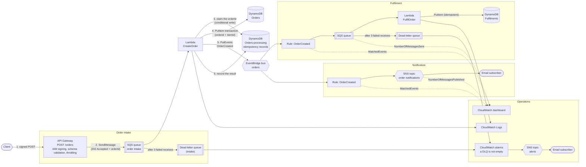
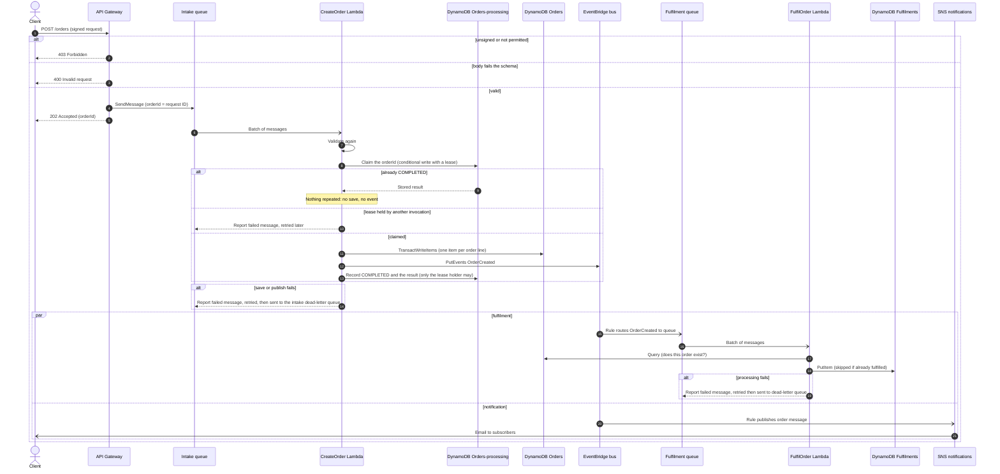
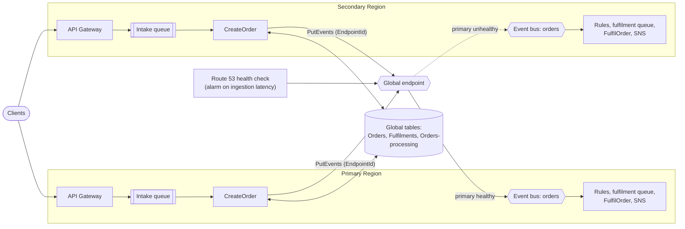
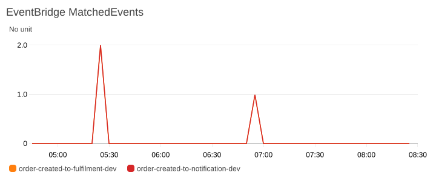
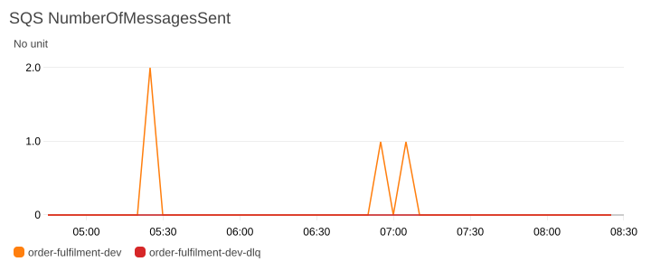
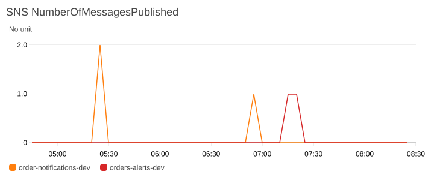

# Secure Event-Driven Orders on AWS

A small event-driven orders backend built the way a production one should be: input is validated, every component has
least-privilege access, failures are retried and dead-lettered, and it is deployed through a pipeline that holds no AWS keys.
Everything is Terraform.

[](https://github.com/bdahiya2007/secure-event-driven-orders-aws/actions/workflows/validate.yml)
[](https://github.com/bdahiya2007/secure-event-driven-orders-aws/actions/workflows/deploy.yml)

A client sends a signed `POST /orders` to API Gateway. The API validates the body against a JSON schema, puts one message on an SQS queue and
immediately answers `202 Accepted` with the new `orderId`, without waiting for any processing. A Python Lambda (`CreateOrder`) consumes
the queue, saves one DynamoDB item per order line in a single transaction, and only then publishes an `OrderCreated` event to a custom
EventBridge bus. Two rules on that bus work independently of each other and of the caller: one feeds a second queue that `FulfilOrder`
consumes to record the fulfilment in its own table, the other publishes a short notification to an SNS topic. Dead-letter queues, CloudWatch
alarms and a dashboard make the failure paths visible.

**State:** deployed and verified end to end in `dev`: a signed order is accepted with `202`, saved by `CreateOrder`, fulfilled, announced by email
and charted, the failure paths (dead-letter queue and alarm) were triggered on purpose, and idempotent processing was checked with repeated and simultaneous deliveries of one message, which create one order. The optional multi-region deployment is applied from a workstation and was verified live: both Regions took orders, events went through the global endpoint, a rehearsed failover routed them to the secondary Region, and fail-back returned them to the primary. `prod` is defined from the same modules and has not
been applied. The repository is public.

## Architecture



Dotted arrows into the dashboard are metrics, not data flow. The caller gets its answer as soon as the order is queued; saving it,
fulfilment and notification all happen afterwards and cannot fail the request.

### Order workflow



## Multi-region (optional)

A switch, `enable_multi_region` (off by default), runs a second copy of the application in a secondary Region (`us-west-2`) and sends events through an EventBridge **global endpoint**. Each Region has its own API Gateway, intake and fulfilment queues, `CreateOrder` and `FulfilOrder` Lambda functions, event bus and SNS topics. The three DynamoDB tables become global tables, so both Regions read and write the same data.



- **What is active-active:** both Regions accept orders at the same time, each through its own API, queue and `CreateOrder`, writing to the same global tables.
- **What is not:** a global endpoint is **active-passive for event routing**. Events go to the primary bus while Route 53 considers the primary healthy, and to the secondary bus after a failover, so fulfilment and notifications run in one Region at a time. Event replication is off, so the secondary rules never process the same event a second time.
- **Failover:** a Route 53 health check follows EventBridge's ingestion-latency metric, and the global endpoint follows the health check. Inverting the health check rehearses a failover and restoring it fails back; in `dev`, events were routed to the secondary within 7 minutes 40 seconds and back to the primary within 97 seconds. Events in flight in the primary when it fails are not copied to the secondary.
- **Cost and operation:** the second copy is idle until used. The extra costs are the replicated writes and a Route 53 health check of about $0.50 a month. It is applied from a workstation, not the pipeline. Setup is in the [Terraform reference](terraform/README.md#multi-region-optional); expectations, failure scenarios, failover steps and gaps are in [docs/DISASTER_RECOVERY.md](docs/DISASTER_RECOVERY.md), with more in the [FAQ](docs/FAQ.md#multi-region).

## What this demonstrates

- **Asynchronous intake:** the API validates and queues, answers `202` straight away, and a consumer saves and publishes; the whole path retries safely, so a saved order is never left unannounced.
- **Event-driven design with clear failure semantics:** save first, publish second, fan out through EventBridge, buffer with SQS, retry with partial-batch failure reporting, dead-letter after three failed receives.
- **Multi-region resilience (optional):** a second Region, global tables and an EventBridge global endpoint with Route 53 failover, behind a switch, with the limits stated.
- **Idempotent processing:** `CreateOrder` claims each `orderId` with a conditional write and a lease, records the result, and answers a repeat with the stored result without saving or publishing again; concurrent copies cannot both proceed. `FulfilOrder` is idempotent in the same spirit.
- **Infrastructure as code, modular:** nine reusable Terraform modules shared by two environments, with remote locked state.
- **Security by default:** least-privilege IAM per function, a permissions boundary on every role the pipeline creates, allow-listed input, TLS-only and source-scoped queue and topic policies, no stored credentials.
- **Delivery discipline:** pull requests are checked offline (format, validate, unit tests, `bandit`, `checkov`, secret scan); pushes to `main` deploy through GitHub OIDC with a guard that refuses to delete or replace anything automatically.
- **Operability:** a dashboard of the three metrics that show the flow, an alarm on the dead-letter queue (tested for real), structured logs that record message IDs and never order contents.
- **Cost awareness:** idle cost is about $0 (see [Cost](#cost-awareness)).

## Observability

The `orders-<env>` CloudWatch dashboard charts the three metrics that show the flow: EventBridge `MatchedEvents` per rule, SQS
`NumberOfMessagesSent` for the queue and its dead-letter queue, and SNS `NumberOfMessagesPublished` per topic. The charts below are
from `dev` during testing: two orders at about 05:30, a few more around 07:00, then a deliberately bad message sent at 07:07 that reached the
dead-letter queue and fired the alarm. The second alerts-topic bump, at about 07:20, is the alarm returning to `OK`.





The dead-letter queue line stays at zero because SQS does not count the move to a dead-letter queue as a send; the alarm on the queue's depth is
what reports it.

## Security design

The full analysis, with each threat, its control and what is still open, is in the [threat model](docs/THREAT_MODEL.md).
To report a vulnerability, see the [security policy](SECURITY.md).

| Area | What is in place |
|---|---|
| **Authentication and authorisation** | `POST /orders` requires an AWS-signed request (SigV4) from a principal allowed `execute-api:Invoke`; unsigned requests get `403`. This is for AWS principals, not for end users (see the open gaps). |
| **Request validation and throttling** | API Gateway rejects a body that does not match the JSON schema (only `customerId`, `items`, `itemId`, `quantity`, with length and range limits, no other fields) before anything is queued, with a fixed `400` message that does not echo the input. The stage is throttled to 10 requests per second (burst 20), and unsupported content types get `415`. |
| **Intake queue** | Only the API's role may send to it (an explicit deny covers everyone else, administrators included); it is encrypted, TLS-only and dead-lettered after three failed receives, with its own alarm. API Gateway's role can do nothing but `SendMessage` on that queue. |
| **Input handling** | `CreateOrder` validates every message again against an allow-list (IDs up to 64 characters, quantity 1 to 1000, up to 100 lines, unique item IDs, a lowercase UUID `orderId`) and drops unknown fields, so nothing on the queue can store arbitrary data. No price field is accepted. `FulfilOrder` re-validates every message instead of trusting the event. |
| **Idempotent processing** | Each `orderId` has one record in a processing table. `CreateOrder` claims it with a conditional write (a lease), so two copies of a message cannot both proceed. A completed order returns its stored result without saving or publishing again, an expired lease is taken over by the next retry, and an `orderId` reused for different content is rejected (the record keeps a fingerprint of the order). Records expire after a week. |
| **Multi-region controls** | The permissions boundary covers the secondary Region, so roles created there stay inside it. Both event buses allow `PutEvents` only to the two `CreateOrder` roles, which are the only principals allowed to use the global endpoint. The one third-party library the multi-region build needs (`awscrt`, for request signing) is pinned to an exact version, downloaded by a script that checks its SHA-256 before unpacking, and packaged only into `CreateOrder`. |
| **No overwrites, no half orders** | Order lines are written in one transaction with a condition expression, so a duplicate `itemId` rejects the whole order. |
| **Least-privilege IAM** | `CreateOrder` can write its own logs, `PutItem` on the Orders table and `PutEvents` on the one bus. `FulfilOrder` can write its own logs, read and delete from the one queue, and `PutItem` on the Fulfilments table. No `*` actions or resources. |
| **Permissions boundary** | Both Lambda roles carry `orders-pipeline-app-role-boundary`, a ceiling that caps them at exactly those actions, even if a role policy were widened later. |
| **Queue and topic policies** | Only the matching EventBridge rule can send to the fulfilment queue or publish to the notification topic (`aws:SourceArn`). All queues and topics deny non-TLS requests. Queues use SQS-managed encryption. |
| **Event authenticity** | The bus policy denies `events:PutEvents` to everyone except the `CreateOrder` role, and `FulfilOrder` checks every event against the stored order (same customer, lines and quantities) before recording a fulfilment, so a forged or altered event cannot create one. |
| **Pipeline identity** | GitHub OIDC with short-lived tokens. The trust policy pins the repository by immutable owner and repository ID and accepts only jobs running in the `dev` or `prod` GitHub environment. No AWS keys are stored anywhere. |
| **Pipeline cannot elevate itself** | The deploy role and boundary live in a separately applied `terraform/bootstrap` stack. The role can only create or modify the two Lambda roles, only with the boundary attached, and explicit denies stop it editing itself or removing the boundary. |
| **Repository rules** | The repository is public. `main` accepts changes only through a pull request with five passing checks (tests, `bandit`, `checkov`, secret scan, Terraform validate), up to date with `main`, administrators included, with no force pushes or deletions. The `dev` and `prod` environments accept only protected branches, and `prod` needs the owner's approval. Secret scanning with push protection, Dependabot alerts and private vulnerability reporting are on, the Actions token is read-only, and merged branches are deleted automatically. |
| **No surprise deletions** | The deploy workflow stops if the plan would delete or replace anything, because a replaced table loses its data. A manual override exists. |
| **State** | Private, versioned, encrypted S3 bucket with TLS-only access and native locking, one key per environment. State and variable files are never committed. |
| **Data protection** | DynamoDB encryption at rest, point-in-time recovery, and deletion protection in prod. |
| **Leak prevention** | A pre-commit hook and a CI job scan for credentials, AWS account and resource IDs, personal data and state or key files, and redact what they report ([details](docs/SECRET_SCANNING.md)). |
| **Static analysis** | `bandit` on the Lambda code and `checkov` on the Terraform for every pull request. Each accepted `checkov` exception is listed with its reason in `.checkov.yaml`. GitHub Actions are pinned by commit SHA. |
| **Log hygiene** | Errors return generic messages, and logs record the error and message ID, never order contents. |

### Open security gaps

Residual risks from the [threat model](docs/THREAT_MODEL.md), highest first. Each ID matches a row in that file.

| Threat | Risk | Gap | Planned fix |
|---|---|---|---|
| **T1** | Medium | The API accepts AWS-signed requests only; there is no end-user identity, so it is not safe to expose to browsers or customers | A Cognito or JWT authorizer |
| **T7** | Medium | The caller's identity is not stored with an order, API access logging is off (it needs an account-wide API Gateway logging role), and CloudTrail coverage is unverified | Record the caller, add API access logs, confirm CloudTrail |
| T22 | Low | The account ID is now masked in the Actions logs (verified), but resource names, queue names and API IDs are still visible in the plan output | Reviewed before the repository became public; the names are not secrets |
| T27 | Low | The commit history shows the author's personal email (also public in the companion repository) and an unlinked placeholder noreply address on 19 commits | Kept deliberately; turn on GitHub's email privacy settings |
| T31 | Low | With multi-region on, events in flight in the primary at a failover are not replicated, replicas lag by about a second, and conditional writes are atomic within a Region only | Enable replication with the secondary rules paused, or accept the window |
| T34 | Low | The pipeline cannot run while the multi-region stack exists, because it plans with the switch off (switching off is verified in `dev`) | A pipeline role and job for the second Region |
| T25 | Low | The deploy role can manage REST APIs in the account, not only this project's, because API IDs are not known in advance | Tag-based access control |
| T11 | Low | The stage is throttled and the consumer capped, but there is no per-caller quota, reserved concurrency or budget alarm | A usage plan, a reserved concurrency limit, an AWS Budget alert |
| T14 | Low | A message that fails three times leaves the order saved but unannounced, in the intake dead-letter queue, until redriven | Redrive tooling (untried) |
| T8, T9 | Low | SNS topics are unencrypted; tables use the AWS-managed key | A customer-managed KMS key |
| T15 | Low | The caller cannot supply an idempotency key, so a retried HTTP request creates a second order; a repeat of one queued message no longer does | Accept a client-supplied order ID |
| T18 | Low | `dev` has no deletion protection, and the pipeline's no-delete guard can be overridden by hand | Keep the override manual and logged |
| T19 | Low | The transitive packages of `bandit` and `checkov` are not pinned (they run with no AWS credentials) | A hashed requirements file for the scan tools |
| T21 | Low | The Terraform state holds the subscription emails in plain text and sits in a bucket shared with another project | A dedicated state bucket, or exclude the addresses from state |

**Not yet tested live:** a burst that trips the stage throttle (`429`), redriving a message from a dead-letter queue back to its source queue,
the retry path after a forced publish failure, and the whole stack in `prod`.

## Cost awareness

Built and run in a personal AWS account, so cost is a design constraint. Idle cost is effectively zero, because everything is
pay-per-use and nothing runs when there is no traffic. Figures are us-east-1 list prices, approximate.

| Item | Approximate cost |
|---|---|
| Lambda, SQS, SNS publishes, CloudWatch alarm, one dashboard, logs | Inside the free tiers at demo volumes |
| DynamoDB (two on-demand tables) | About $0.625 per million writes and $0.125 per million reads |
| EventBridge custom events | $1.00 per million |
| SNS email delivery | First 1,000 free, then about $2 per 100,000 (the largest per-order cost) |
| Multi-region switch on (optional) | The second Region is idle until used. Added: replicated DynamoDB writes (each write is billed in both Regions) and one Route 53 health check, about $0.50 a month |
| About 100,000 orders a month | Roughly $1 to $3 in total |

There is no VPC, NAT gateway or provisioned capacity. See the [FAQ](docs/FAQ.md#cost) for what could add cost.

## Repository layout

```
.
├── .github/
│   ├── workflows/             # validate.yml (pull requests), deploy.yml (push to main)
│   └── dependabot.yml         # weekly grouped updates for the pinned actions
├── SECURITY.md                # how to report a vulnerability
├── .checkov.yaml              # reviewed checkov exceptions, each with a reason
├── .githooks/pre-commit       # runs the secret scan before every commit
├── docs/
│   ├── THREAT_MODEL.md        # STRIDE threat model, controls and residual risks
│   ├── DISASTER_RECOVERY.md   # multi-region objectives, failover steps, gaps
│   ├── FAQ.md                 # design, behaviour, operations and CI/CD questions
│   └── SECRET_SCANNING.md     # what the scanner blocks and how to use it
├── scripts/                   # secret-scan.py, install-hooks.sh, vendor_awscrt.py (multi-region build)
├── tests/                     # Lambda unit tests (standard library only)
└── terraform/
    ├── README.md              # modules, variables, remote state, CI/CD, dashboard
    ├── backend.hcl.example    # state bucket name; copy to backend.hcl (git-ignored)
    ├── bootstrap/             # deploy role (GitHub OIDC) and permissions boundary, applied manually
    ├── iam/                   # IAM statements the deploying identity needs
    ├── modules/
    │   ├── alerts/            # SNS topic for alarms
    │   ├── create_order/      # CreateOrder Lambda, IAM role, log group, SQS trigger
    │   ├── dashboard/         # CloudWatch dashboard
    │   ├── dynamodb/          # DynamoDB table (on-demand, encrypted, PITR, deletion protection)
    │   ├── event_queue/       # SQS queue (intake and fulfilment), dead-letter queue, policies, alarm
    │   ├── event_rule/        # EventBridge rule to a target
    │   ├── eventbridge/       # custom event bus
    │   ├── global_endpoint/   # EventBridge global endpoint, health check and failover alarm
    │   ├── fulfil_order/      # FulfilOrder Lambda, IAM role, SQS trigger
    │   └── notification_topic/# SNS topic for order notifications
    └── environments/
        ├── dev/
        └── prod/
```

## Try it

Deploying needs Terraform 1.10 or newer and AWS credentials that can manage the project's resources, including the two Lambda roles
(see [terraform/iam](terraform/iam/deploy-iam-policy.json)). The role and boundary used by the pipeline are created once from `terraform/bootstrap`.

```bash
cd terraform/environments/dev
terraform init -backend-config=../../backend.hcl   # copy backend.hcl.example to backend.hcl first
terraform apply
```

Subscribe an address to the notification and alert topics with `notification_email` and `alert_email`, kept in a git-ignored
`emails.auto.tfvars`; confirm the two emails AWS sends. Then create an order. The API needs a signed request, so use credentials
allowed `execute-api:Invoke` (curl 7.75 or newer signs requests itself):

```bash
URL=$(terraform output -raw order_api_url)
curl -s -X POST "$URL" \
  --aws-sigv4 "aws:amz:us-east-1:execute-api" --user "$AWS_ACCESS_KEY_ID:$AWS_SECRET_ACCESS_KEY" \
  -H "x-amz-security-token: $AWS_SESSION_TOKEN" -H "Content-Type: application/json" \
  -d '{"customerId":"c1","items":[{"itemId":"i1","quantity":2}]}'
```

| Response | Meaning |
|---|---|
| `202` | Accepted: the order is queued, not yet saved. Body is `{"orderId": "...", "status": "ACCEPTED"}` |
| `400` | The body does not match the schema, or repeats an `itemId`. Nothing was queued |
| `403` | The request was not signed, or the caller may not invoke the API |
| `415` | The content type is not `application/json` |
| `429` | Throttled |
| `500` | The queue could not be written; nothing was accepted |

A moment later the order is saved, `Fulfilments-dev` holds a `FULFILLED` record for that `orderId`, and the notification email arrives.
Because the answer is only `202`, a client learns about a failed order from the dead-letter alarm, not from the response. Full
setup, variables and the dashboard are in the [Terraform reference](terraform/README.md).

## CI/CD

| Workflow | Trigger | What it does |
|---|---|---|
| `validate.yml` | Pull requests | Offline checks, no AWS credentials: `terraform fmt`, `validate` for both environments, handler compile check, 25 unit tests, `bandit`, `checkov`, secret scan |
| `deploy.yml` | Push to `main` (documentation-only changes skipped), or manual | Checks, `init`, `validate`, `plan`, a no-delete guard, then `apply` of exactly that plan |

`deploy.yml` assumes the deploy role through GitHub OIDC and needs four repository secrets: `AWS_DEPLOY_ROLE_ARN`, `TF_STATE_BUCKET`,
`NOTIFICATION_EMAIL` and `ALERT_EMAIL`. The pinned actions are kept current by a weekly grouped Dependabot pull request (`.github/dependabot.yml`), which runs the same checks. Lambda packaging is part of Terraform: `archive_file` zips each handler during the plan and the
apply updates a function when its code hash changes, so there is no separate `update-function-code` step. Setup of the role and the
safeguards are described in the [Terraform reference](terraform/README.md#cicd-github-actions).

## Design decisions

- **Terraform, not SAM.** The whole stack, including the Lambdas and the pipeline role, is one tool. Nothing in the design depends on it.
- **Queue first, then process.** API Gateway writes straight to SQS with no Lambda in the request path, so the caller is never held up by DynamoDB or EventBridge, and a burst piles up in the queue instead of failing. The cost is that `202` means accepted, not created.
- **Save first, publish second, and retry the pair.** A failed save never produces an event for an order that does not exist. If the publish fails after a successful save, the message returns to the queue; the retry finds the order already stored, confirms it is the same order, and publishes again, so a saved order is not left unannounced.
- **Idempotent by lease, not by luck.** Reading "has this order been processed?" and then acting would let two copies race, so the check and the claim are one conditional write. The holder gets a lease; a crashed holder's lease runs out and the next retry takes over. The result is recorded only by the lease holder, and a record that is `COMPLETED` is never overwritten. Publishing an event cannot be made exactly once (the event can go out and the result still fail to be written), so that one window can repeat an event; the consumers tolerate it.
- **A global endpoint, with replication off.** Replication would copy every event to the secondary bus, where the secondary rules would process it again (duplicate fulfilment work and emails). With it off, events go to one bus at a time. The price: events in flight in the primary when it fails are not available in the secondary.
- **Global tables for the data.** `FulfilOrder` checks each event against the order table and `CreateOrder` keeps its idempotency records in a table, so both Regions must see the same data. Replication is eventual and last-writer-wins, so conditional writes are atomic within a Region only; a check that runs before an order has replicated simply fails and is retried.
- **Off by default, applied by hand.** The pipeline applies one Region with the switch off, and the secondary is applied from a workstation. This keeps the pipeline's permissions unchanged.
- **The request ID is the order ID.** API Gateway's request ID (a UUID) is the `orderId`, so the caller has it immediately and every retry of one message refers to the same order. A client that retries the whole request still creates a second order (no idempotency key yet).
- **AWS IAM signing for the API.** It needs no extra service and keeps the endpoint closed to anyone without credentials. It suits service-to-service callers; an end-user flow would add Cognito or another authorizer.
- **EventBridge, then SQS.** The bus lets consumers be added without touching `CreateOrder` (the notification rule was added that way). The queue absorbs bursts, retries failures and keeps unprocessable messages in a dead-letter queue.
- **At-least-once everywhere, idempotent where it matters.** Fulfilment is safe against repeats; the notification path is not deduplicated, so a rare repeat could send two emails.
- **Two SNS topics.** Order messages and operational alarms go to different topics so different people can subscribe.
- **Python 3.14 with no packaged libraries.** The functions use only the standard library and the runtime's `boto3`, so there is nothing to bundle, pin or patch. This needs AWS provider 6.x, because 5.x rejects the runtime name.
- **One item per order line.** `orderId` plus `itemId` as the key means one query returns a whole order and a duplicate line is rejected; `Fulfilments` needs only `orderId`.
- **Boundary and bootstrap by hand.** Slightly more manual work, in exchange for a pipeline that cannot rewrite its own permissions.
- **Shared state bucket.** State lives in the existing bucket of another project in the same account, under its own key prefix, instead of a second bucket.

More questions and answers are in the [FAQ](docs/FAQ.md).

## Known limitations and roadmap

| Gap | Impact | Next step |
|---|---|---|
| **No end-user authentication** | The API accepts AWS-signed requests only, so it suits other services, not browsers or customers | Add a Cognito or JWT authorizer |
| **Fulfilment only records `FULFILLED`** | There is no inventory or shipping logic | Real processing in `FulfilOrder` |
| **A failed order is only visible as an alarm** | The caller gets `202` before the order is saved, so a message that fails three times ends in the intake dead-letter queue and the alarm; the order may be saved but unannounced until it is redriven | Redrive tooling, and an order status the caller can read |
| **The caller cannot supply an idempotency key** | `orderId` is API Gateway's request ID, so a client that retries the whole HTTP request creates a second order. Redeliveries of one queued message are now fully idempotent | Accept a client-supplied order ID and return the stored result for it |
| **Multi-region is optional and partly manual** | Events in flight in the primary at a failover are not replicated; replicas lag by about a second, so an order checked in the other Region can fail once and be retried; clients choose an API URL themselves (no DNS routing, which needs a domain); the pipeline cannot run while the secondary stack exists, because its permissions cover one Region only (its plan fails reading the other Region) | Route 53 latency or failover routing for the API, and a pipeline role for the second Region |
| **SNS topics and table keys** | Topics are unencrypted (EventBridge and CloudWatch need a customer-managed key); tables use the AWS-managed key | A customer-managed KMS key |
| **No event replay** | An event with no matching rule, or a consumer added later, cannot see past events | An EventBridge archive |
| **No `pip-audit` yet** | Nothing to audit until the Lambdas have a pinned requirements file | Add it with the first third-party dependency |

**Tried and working in `dev`:** the signed order API, three attempts then the dead-letter queue and the alarm on both the intake and the fulfilment queue, the forged-event controls, a multi-region failover and fail-back, and switching multi-region back off ([DISASTER_RECOVERY.md](docs/DISASTER_RECOVERY.md)). **Not tried:** redriving from a dead-letter queue, a throttle burst, a forced publish failure, and a real Region outage.

### Built, but switched off

| Feature | State |
|---|---|
| **Multi-region** (`enable_multi_region`) | Off by default in both environments. When on it adds a second Region's API, queues, functions and rules, global tables and an EventBridge global endpoint with a Route 53 health check. Applied from a workstation, rehearsed live in `dev` (failover and fail-back), and costs the replicated writes plus about $0.50 a month for the health check. While the secondary stack exists the pipeline cannot run, so switch it off first (verified in `dev`; the tables keep their streams so the switch-off works). See [DISASTER_RECOVERY.md](docs/DISASTER_RECOVERY.md). |
| **`awscrt` packaging** | Only built when the multi-region switch is on, because signing for a global endpoint needs it and the Lambda runtime lacks it. With the switch off, the `CreateOrder` package is the handler alone. |
| **The `prod` environment** | Written and validated by the pipeline's offline checks, but never applied. Nothing in this README has been demonstrated there. |

### Out of scope on purpose

| Not done | Why |
|---|---|
| A browser front end | The API accepts AWS-signed requests only, so it suits other services. A browser client would need end-user authentication first (listed above). |
| Update, delete, list and order-status endpoints | The project demonstrates one create path and the events behind it. A list needs a design (a `Scan` is unbounded), and a status endpoint needs the caller to own the order. |
| A custom domain, and DNS routing between Regions | Needs a domain the project does not own. Callers pick an API URL themselves, as the gaps above say. |
| A VPC, NAT gateway or private endpoints | Every service used is reached over its public AWS endpoint with IAM, and there are no private resources to protect. A NAT gateway would be the largest idle cost in the project. |
| WAF, response caching and provisioned concurrency | Each bills while idle or makes results stale, and none has been measured here. The API has stage-level throttling limits instead. |
| More than two environments, or more than two Regions | `dev` and `prod` with an optional second Region show the pattern. More copies would add cost, not understanding. |
| Real fulfilment logic | `FulfilOrder` records `FULFILLED` to show the event flow. Inventory and shipping are a business domain, not part of the architecture being shown. |

## Related

[secure-serverless-api-aws](https://github.com/bdahiya2007/secure-serverless-api-aws) is a companion project (an authenticated REST API with a
direct DynamoDB integration) that uses the same OIDC pipeline pattern and shares this project's state bucket. [three-tier-web-app-aws](https://github.com/bdahiya2007/three-tier-web-app-aws)
applies the same approach with CloudFormation.

## License

All rights reserved. This repository is a portfolio project, published for viewing. No license is granted to copy, modify or redistribute
the code. You are welcome to read it and to fork it on GitHub.
