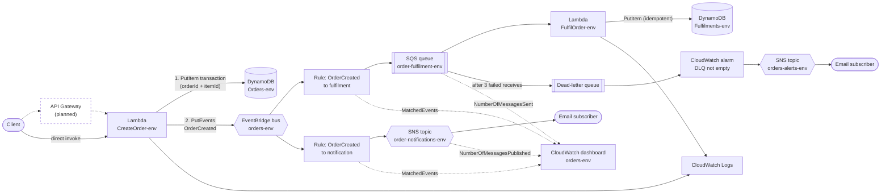
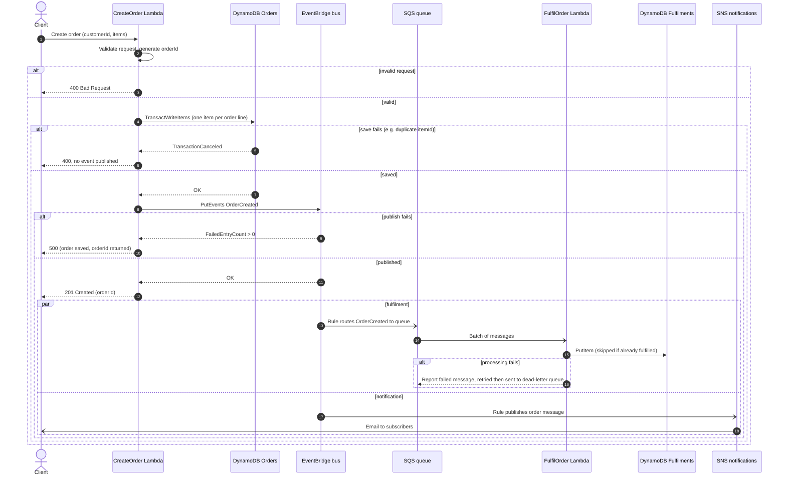

# Secure Event-Driven Orders on AWS

A serverless, event-driven orders application on AWS, defined as infrastructure as code with Terraform. An order is saved synchronously, then fulfilled and announced asynchronously through EventBridge, SQS and SNS.

## Status

| Component | Status |
|---|---|
| `CreateOrder` Lambda, `Orders` table, event bus | Deployed and verified in `dev` |
| Rule → SQS → `FulfilOrder` → `Fulfilments` table | Deployed and verified in `dev` |
| Rule → SNS order notification email | Deployed and verified in `dev` |
| CloudWatch dashboard `orders-<env>` | Deployed in `dev` |
| Dead-letter queue alarm | Deployed in `dev`; failure path not yet tested |
| `prod` environment | Defined, not applied |
| Remote state in S3 (versioned, encrypted, native locking) | `dev` migrated and verified (`plan` shows no changes); `prod` will use it from its first init |
| GitHub Actions: `validate.yml` and `deploy.yml` (OIDC) | Written and syntax-checked; not yet run (no GitHub repository yet, `terraform/bootstrap` not applied, secrets not set) |
| API Gateway, KMS customer-managed keys, CI scanning | Planned |

## What it does

- **Orders table:** DynamoDB `Orders-<env>` with partition key `orderId` and sort key `itemId`. It is on-demand, encrypted, has point-in-time recovery, and deletion protection in prod.
- **CreateOrder:** Lambda `CreateOrder-<env>` (Python 3.14) validates the request against an allow-list, generates an `orderId`, saves one item per order line in a single transaction, then publishes an `OrderCreated` event to the `orders-<env>` EventBridge bus. The event is never published if the save fails.
- **Fulfilment:** a rule routes `OrderCreated` to the SQS queue `order-fulfilment-<env>`. Lambda `FulfilOrder-<env>` consumes it in batches and writes one idempotent record per order to `Fulfilments-<env>`. Failed messages are retried and then moved to a dead-letter queue.
- **Notification:** a second rule publishes a short message (`Order <orderId> was created at <createdAt>.`, no customer data) to the SNS topic `order-notifications-<env>`, with an optional email subscriber.
- **Dashboard:** a CloudWatch dashboard `orders-<env>` charts EventBridge `MatchedEvents` per rule, SQS `NumberOfMessagesSent` for the queue and dead-letter queue, and SNS `NumberOfMessagesPublished` per topic.
- **Alerting:** a CloudWatch alarm notifies the `orders-alerts-<env>` SNS topic whenever the dead-letter queue is not empty.
- **Environments:** `dev` and `prod` are built from the same shared modules and have separate state in S3 (one key per environment, with native locking).

## Architecture



Solid lines and boxes are deployed by the current Terraform. The dashed API Gateway box and its arrows are planned. The dotted arrows into the dashboard are metrics (not data flow); the dashboard also charts the dead-letter queue and the alerts topic. The API call returns once the order is saved and the event is published. Fulfilment and notification happen asynchronously and independently, so a failure in one does not affect the other or the caller.

## Order workflow



## Repository layout

```
.
├── .github/workflows/         # validate.yml (pull requests), deploy.yml (push to main)
├── .gitignore                 # state, secrets, build output
├── README.md
├── TODO.md                    # open work, grouped by area (local only, git-ignored)
├── .githooks/pre-commit       # runs the secret scan before every commit
├── scripts/                   # secret-scan.py, install-hooks.sh
├── docs/
│   ├── SECRET_SCANNING.md     # what the scanner blocks and how to use it
│   └── FAQ.md                 # design, behaviour and operations questions
└── terraform/
    ├── README.md
    ├── backend.hcl.example    # S3 state bucket name; copy to backend.hcl (git-ignored)
    ├── bootstrap/             # deploy role (GitHub OIDC) and permissions boundary, applied manually
    ├── iam/                   # least-privilege IAM policy for the deploying user
    ├── modules/
    │   ├── dynamodb/          # DynamoDB table (on-demand, SSE, PITR, deletion protection)
    │   ├── eventbridge/       # custom event bus
    │   ├── event_rule/        # EventBridge rule to a target
    │   ├── event_queue/       # SQS queue, dead-letter queue, policies, DLQ alarm
    │   ├── notification_topic/# SNS topic for order notifications
    │   ├── dashboard/         # CloudWatch dashboard
    │   ├── alerts/            # SNS topic for alarms
    │   ├── create_order/      # CreateOrder Lambda, IAM role, log group
    │   └── fulfil_order/      # FulfilOrder Lambda, IAM role, SQS trigger
    └── environments/
        ├── dev/
        └── prod/
```

## Quick start

```bash
aws sso login --profile <your-profile>
cd terraform/environments/dev
terraform init -backend-config=../../backend.hcl   # copy backend.hcl.example to backend.hcl first
terraform plan
terraform apply -var notification_email=you@example.com -var alert_email=you@example.com
# or put both in a git-ignored emails.auto.tfvars so later plans keep the subscriptions
```

Confirm the two subscription emails AWS sends (one per SNS topic). Then create a test order:

```bash
aws lambda invoke --function-name CreateOrder-dev \
  --cli-binary-format raw-in-base64-out \
  --payload '{"customerId":"c1","items":[{"itemId":"i1","quantity":1}]}' out.json
cat out.json
```

Check `Fulfilments-dev` for a `FULFILLED` record and your inbox for the notification. Deploying needs IAM permissions to manage the roles `CreateOrder-*` and `FulfilOrder-*`; see [terraform/iam/deploy-iam-policy.json](terraform/iam/deploy-iam-policy.json). See [terraform/README.md](terraform/README.md) for module details and [docs/FAQ.md](docs/FAQ.md) for common questions.

## Deploying from GitHub Actions

Pushes to `main` deploy `dev` through `.github/workflows/deploy.yml`, and pull requests are checked offline by `validate.yml`. It authenticates with **GitHub OIDC** (no AWS keys stored) and needs four **repository secrets**: `AWS_DEPLOY_ROLE_ARN`, `TF_STATE_BUCKET`, `NOTIFICATION_EMAIL` and `ALERT_EMAIL`. The deploy role is created once, manually, from `terraform/bootstrap`. Set them in the repository's Settings, Secrets and variables, Actions (or with `gh secret set`); never commit their values. What each one holds, the one-time role setup and the safeguards are described in [terraform/README.md](terraform/README.md#cicd-github-actions).

## Security

Implemented:

- GitHub Actions authenticates with OIDC (short-lived tokens, trust pinned to this repository and the dev or prod environment) and its role is bounded: it can only create the two Lambda roles, and only with a permissions boundary
- Least-privilege IAM: each Lambda role can touch only its own log group, queue, table and bus
- Allow-listed, type-checked input; only `customerId`, `itemId` and `quantity` are stored
- Idempotent fulfilment and bounded retries, with failed messages kept in a dead-letter queue
- SQS queues are encrypted and reject non-TLS requests; only the matching EventBridge rule can send to the queue or publish to the notification topic
- DynamoDB encryption at rest, point-in-time recovery, and deletion protection in prod
- No secrets in code; a secret scanner (pre-commit hook and CI job, see [docs/SECRET_SCANNING.md](docs/SECRET_SCANNING.md)) blocks credentials, account IDs, emails and personal paths, and state, `*.tfvars`, `.env` and key files are git-ignored

Known gaps:

- The SNS topics are not KMS-encrypted, because EventBridge and CloudWatch cannot use the AWS-managed `aws/sns` key
- Tables use the AWS-managed DynamoDB key rather than a customer-managed key
- State is kept in a bucket shared with another project in the same account; there is no separate state account or cross-account access control
- There is no static scanning (tfsec / Checkov) yet; the bootstrap that creates the deploy role is applied by hand with local state

## Roadmap

- API Gateway in front of `CreateOrder`
- Real fulfilment logic (inventory, shipping) in `FulfilOrder`
- Customer-managed KMS key for the tables and SNS topics
- CI security scans (`tfsec` / Checkov, `bandit`, `pip-audit`) and Lambda unit tests in `validate.yml`
- Test the dead-letter queue alarm and apply `prod`
