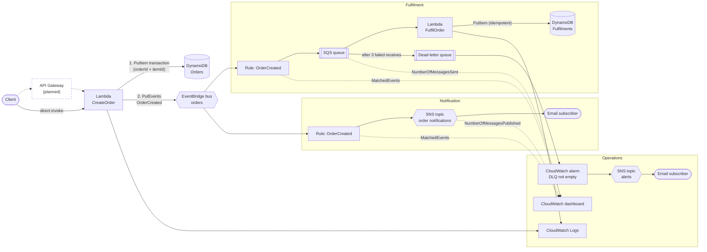
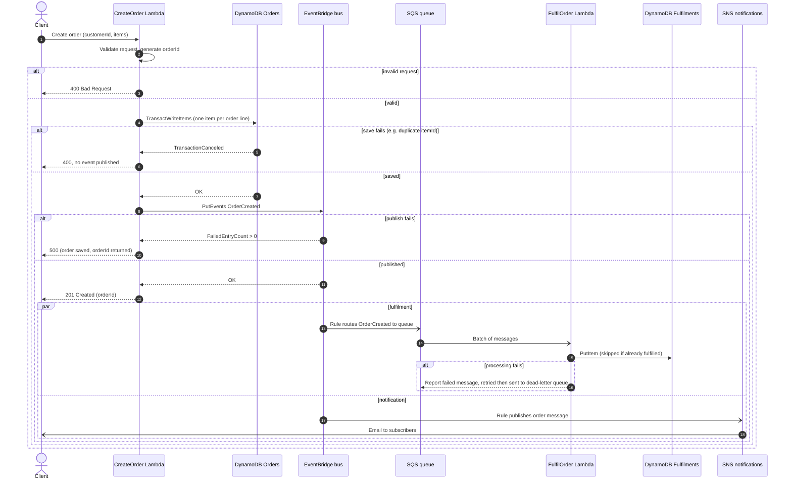

# Secure Event-Driven Orders on AWS

A small event-driven orders backend built the way a production one should be: input is validated, every component has
least-privilege access, failures are retried and dead-lettered, and it is deployed through a pipeline that holds no AWS keys.
Everything is Terraform.

[](https://github.com/bdahiya2007/secure-event-driven-orders-aws/actions/workflows/validate.yml)
[](https://github.com/bdahiya2007/secure-event-driven-orders-aws/actions/workflows/deploy.yml)

A client creates an order. A Python Lambda validates it against an allow-list, saves one DynamoDB item per order line in a single
transaction, and only then publishes an `OrderCreated` event to a custom EventBridge bus. Two rules on that bus work independently of
each other and of the caller: one feeds an SQS queue that a second Lambda (`FulfilOrder`) consumes to record the fulfilment in its own
table, the other publishes a short notification to an SNS topic. A dead-letter queue, a CloudWatch alarm and a dashboard make the
failure paths visible.

**State:** deployed and verified end to end in `dev` (order, fulfilment, notification email, dashboard, and a dead-letter queue alarm that
was triggered on purpose). `prod` is defined from the same modules and has not been applied.

## Architecture



Solid boxes and lines are deployed. The dashed API Gateway box is planned. Dotted arrows into the dashboard are metrics, not data flow.
The caller gets its answer once the order is saved and the event is published; fulfilment and notification happen afterwards and
cannot fail the request.

### Order workflow



## What this demonstrates

- **Event-driven design with clear failure semantics:** save first, publish second, fan out through EventBridge, buffer with SQS, retry with partial-batch failure reporting, dead-letter after three failed receives.
- **Idempotent consumers:** a redelivered message is a successful no-op, because the fulfilment write is conditional on the `orderId`.
- **Infrastructure as code, modular:** nine reusable Terraform modules shared by two environments, with remote locked state.
- **Security by default:** least-privilege IAM per function, a permissions boundary on every role the pipeline creates, allow-listed input, TLS-only and source-scoped queue and topic policies, no stored credentials.
- **Delivery discipline:** pull requests are checked offline (format, validate, unit tests, `bandit`, `checkov`, secret scan); pushes to `main` deploy through GitHub OIDC with a guard that refuses to delete or replace anything automatically.
- **Operability:** a dashboard of the three metrics that show the flow, an alarm on the dead-letter queue (tested for real), structured logs that record message IDs and never order contents.
- **Cost awareness:** idle cost is about $0 (see [Cost](#cost-awareness)).

## Observability

The `orders-<env>` CloudWatch dashboard charts the three metrics that show the flow: EventBridge `MatchedEvents` per rule, SQS
`NumberOfMessagesSent` for the queue and its dead-letter queue, and SNS `NumberOfMessagesPublished` per topic. The charts below are
from `dev` during testing: two orders at about 05:30, a few more around 07:00, then a deliberately bad message sent at 07:07 that reached the
dead-letter queue and fired the alarm. The second alerts-topic bump, at about 07:20, is the alarm returning to `OK`.


The dead-letter queue line stays at zero because SQS does not count the move to a dead-letter queue as a send; the alarm on the queue's depth is
what reports it.

## Security design

The full analysis, with each threat, its control and what is still open, is in the [threat model](docs/THREAT_MODEL.md).

| Area | What is in place |
|---|---|
| **Input handling** | `CreateOrder` stores only `customerId`, `itemId` and `quantity`, with type and length checks (IDs up to 64 characters, quantity 1 to 1000, up to 100 lines, body up to 256 KB). Unknown fields are dropped, so a caller cannot store arbitrary data or override the server-set `orderId` and `createdAt`. No price field is accepted. `FulfilOrder` re-validates every message instead of trusting the event. |
| **No overwrites, no half orders** | Order lines are written in one transaction with a condition expression, so a duplicate `itemId` rejects the whole order. |
| **Least-privilege IAM** | `CreateOrder` can write its own logs, `PutItem` on the Orders table and `PutEvents` on the one bus. `FulfilOrder` can write its own logs, read and delete from the one queue, and `PutItem` on the Fulfilments table. No `*` actions or resources. |
| **Permissions boundary** | Both Lambda roles carry `orders-pipeline-app-role-boundary`, a ceiling that caps them at exactly those actions, even if a role policy were widened later. |
| **Queue and topic policies** | Only the matching EventBridge rule can send to the fulfilment queue or publish to the notification topic (`aws:SourceArn`). All queues and topics deny non-TLS requests. Queues use SQS-managed encryption. |
| **Pipeline identity** | GitHub OIDC with short-lived tokens. The trust policy pins the repository by immutable owner and repository ID and accepts only jobs running in the `dev` or `prod` GitHub environment. No AWS keys are stored anywhere. |
| **Pipeline cannot elevate itself** | The deploy role and boundary live in a separately applied `terraform/bootstrap` stack. The role can only create or modify the two Lambda roles, only with the boundary attached, and explicit denies stop it editing itself or removing the boundary. |
| **No surprise deletions** | The deploy workflow stops if the plan would delete or replace anything, because a replaced table loses its data. A manual override exists. |
| **State** | Private, versioned, encrypted S3 bucket with TLS-only access and native locking, one key per environment. State and variable files are never committed. |
| **Data protection** | DynamoDB encryption at rest, point-in-time recovery, and deletion protection in prod. |
| **Leak prevention** | A pre-commit hook and a CI job scan for credentials, AWS account and resource IDs, personal data and state or key files, and redact what they report ([details](docs/SECRET_SCANNING.md)). |
| **Static analysis** | `bandit` on the Lambda code and `checkov` on the Terraform for every pull request. Each accepted `checkov` exception is listed with its reason in `.checkov.yaml`. GitHub Actions are pinned by commit SHA. |
| **Log hygiene** | Errors return generic messages, and logs record the error and message ID, never order contents. |

## Cost awareness

Built and run in a personal AWS account, so cost is a design constraint. Idle cost is effectively zero, because everything is
pay-per-use and nothing runs when there is no traffic. Figures are us-east-1 list prices, approximate.

| Item | Approximate cost |
|---|---|
| Lambda, SQS, SNS publishes, CloudWatch alarm, one dashboard, logs | Inside the free tiers at demo volumes |
| DynamoDB (two on-demand tables) | About $0.625 per million writes and $0.125 per million reads |
| EventBridge custom events | $1.00 per million |
| SNS email delivery | First 1,000 free, then about $2 per 100,000 (the largest per-order cost) |
| About 100,000 orders a month | Roughly $1 to $3 in total |

There is no VPC, NAT gateway or provisioned capacity. See the [FAQ](docs/FAQ.md#cost) for what could add cost.

## Repository layout

```
.
├── .github/workflows/         # validate.yml (pull requests), deploy.yml (push to main)
├── .checkov.yaml              # reviewed checkov exceptions, each with a reason
├── .githooks/pre-commit       # runs the secret scan before every commit
├── docs/
│   ├── THREAT_MODEL.md        # STRIDE threat model, controls and residual risks
│   ├── FAQ.md                 # design, behaviour, operations and CI/CD questions
│   └── SECRET_SCANNING.md     # what the scanner blocks and how to use it
├── scripts/                   # secret-scan.py, install-hooks.sh
├── tests/                     # Lambda unit tests (standard library only)
└── terraform/
    ├── README.md              # modules, variables, remote state, CI/CD, dashboard
    ├── backend.hcl.example    # state bucket name; copy to backend.hcl (git-ignored)
    ├── bootstrap/             # deploy role (GitHub OIDC) and permissions boundary, applied manually
    ├── iam/                   # IAM statements the deploying identity needs
    ├── modules/
    │   ├── alerts/            # SNS topic for alarms
    │   ├── create_order/      # CreateOrder Lambda, IAM role, log group
    │   ├── dashboard/         # CloudWatch dashboard
    │   ├── dynamodb/          # DynamoDB table (on-demand, encrypted, PITR, deletion protection)
    │   ├── event_queue/       # SQS queue, dead-letter queue, policies, dead-letter alarm
    │   ├── event_rule/        # EventBridge rule to a target
    │   ├── eventbridge/       # custom event bus
    │   ├── fulfil_order/      # FulfilOrder Lambda, IAM role, SQS trigger
    │   └── notification_topic/# SNS topic for order notifications
    └── environments/
        ├── dev/
        └── prod/
```

## Try it

Deploying needs Terraform 1.10 or newer and AWS credentials that can manage the project's resources, including the two Lambda roles
(see [terraform/iam](terraform/iam/deploy-iam-policy.json)). The role and boundary used by the pipeline are created once from `terraform/bootstrap`.

```bash
cd terraform/environments/dev
terraform init -backend-config=../../backend.hcl   # copy backend.hcl.example to backend.hcl first
terraform apply
```

Subscribe an address to the notification and alert topics with `notification_email` and `alert_email`, kept in a git-ignored
`emails.auto.tfvars`; confirm the two emails AWS sends. Then create an order:

```bash
aws lambda invoke --function-name CreateOrder-dev \
  --cli-binary-format raw-in-base64-out \
  --payload '{"customerId":"c1","items":[{"itemId":"i1","quantity":2}]}' out.json
cat out.json
```

| Response | Meaning |
|---|---|
| `201` | Saved and published; body is `{"orderId": "..."}` |
| `400` | Invalid request, or a duplicate `itemId` in the order. Nothing was saved or published |
| `500` | An AWS error. If the body contains an `orderId`, the order was saved but the event could not be published |

A second or two later, `Fulfilments-dev` holds a `FULFILLED` record for that `orderId` and the notification email arrives. Full
setup, variables and the dashboard are in the [Terraform reference](terraform/README.md).

## CI/CD

| Workflow | Trigger | What it does |
|---|---|---|
| `validate.yml` | Pull requests | Offline checks, no AWS credentials: `terraform fmt`, `validate` for both environments, handler compile check, 25 unit tests, `bandit`, `checkov`, secret scan |
| `deploy.yml` | Push to `main` (documentation-only changes skipped), or manual | Checks, `init`, `validate`, `plan`, a no-delete guard, then `apply` of exactly that plan |

`deploy.yml` assumes the deploy role through GitHub OIDC and needs four repository secrets: `AWS_DEPLOY_ROLE_ARN`, `TF_STATE_BUCKET`,
`NOTIFICATION_EMAIL` and `ALERT_EMAIL`. Lambda packaging is part of Terraform: `archive_file` zips each handler during the plan and the
apply updates a function when its code hash changes, so there is no separate `update-function-code` step. Setup of the role and the
safeguards are described in the [Terraform reference](terraform/README.md#cicd-github-actions).

## Design decisions

- **Terraform, not SAM.** The whole stack, including the Lambdas and the pipeline role, is one tool. Nothing in the design depends on it.
- **Save first, publish second.** A failed save never produces an event for an order that does not exist. The reverse gap (saved, publish failed) returns a `500` carrying the `orderId`; closing it needs DynamoDB Streams with EventBridge Pipes.
- **EventBridge, then SQS.** The bus lets consumers be added without touching `CreateOrder` (the notification rule was added that way). The queue absorbs bursts, retries failures and keeps unprocessable messages in a dead-letter queue.
- **At-least-once everywhere, idempotent where it matters.** Fulfilment is safe against repeats; the notification path is not deduplicated, so a rare repeat could send two emails.
- **Two SNS topics.** Order messages and operational alarms go to different topics so different people can subscribe.
- **Python 3.14 with no packaged libraries.** The functions use only the standard library and the runtime's `boto3`, so there is nothing to bundle, pin or patch. This needs AWS provider 6.x, because 5.x rejects the runtime name.
- **One item per order line.** `orderId` plus `itemId` as the key means one query returns a whole order and a duplicate line is rejected; `Fulfilments` needs only `orderId`.
- **Boundary and bootstrap by hand.** Slightly more manual work, in exchange for a pipeline that cannot rewrite its own permissions.
- **Shared state bucket.** State lives in the existing bucket of another project in the same account, under its own key prefix, instead of a second bucket.

More questions and answers are in the [FAQ](docs/FAQ.md).

## Known limitations and roadmap

| Gap | Impact | Next step |
|---|---|---|
| **No API in front of `CreateOrder`** | It is invoked directly, so there is no authentication, throttling or request validation at the edge | API Gateway with an authorizer, schema validation and throttling |
| **Fulfilment only records `FULFILLED`** | There is no inventory or shipping logic | Real processing in `FulfilOrder` |
| **Saved but not published** | If the publish fails after a successful save, the order is never fulfilled or announced | DynamoDB Streams with EventBridge Pipes |
| **No idempotency key on create** | A client retry creates a second order | Accept and store a client-supplied key |
| **SNS topics and table keys** | Topics are unencrypted (EventBridge and CloudWatch need a customer-managed key); tables use the AWS-managed key | A customer-managed KMS key |
| **No event replay** | An event with no matching rule, or a consumer added later, cannot see past events | An EventBridge archive |
| **Repository protection** | No branch protection or `prod` approval gate: the repository is private on the free GitHub plan, which does not offer them | Make the repository public (after hiding the plan from the Actions log and masking the account ID) or upgrade |
| **No `pip-audit` yet** | Nothing to audit until the Lambdas have a pinned requirements file | Add it with the first third-party dependency |

**Built but not applied:** the `prod` environment. **Tried and working:** retries and the dead-letter queue alarm. **Not tried:** redriving messages from the dead-letter queue back to the main queue.

## Related

[secure-serverless-api-aws](https://github.com/bdahiya2007/secure-serverless-api-aws) is a companion project (an authenticated REST API with a
direct DynamoDB integration) that uses the same OIDC pipeline pattern and shares this project's state bucket. [three-tier-web-app-aws](https://github.com/bdahiya2007/three-tier-web-app-aws)
applies the same approach with CloudFormation.
