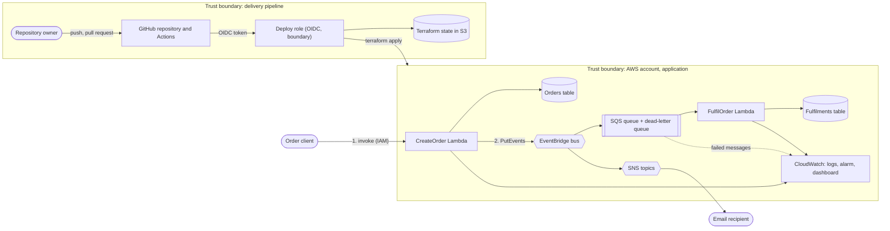

# Threat model

A STRIDE threat model of the orders stack and the pipeline that deploys it. It lists what is protected, where the trust boundaries are, which
threats apply, which control covers each one, and what is still open. Ratings are the author's judgement for this project at its current
size, not a formal score. Controls named here exist in the code; gaps are listed rather than hidden.

**Scope:** the `dev` and `prod` environments as defined in `terraform/`, the GitHub Actions pipeline, and the Terraform state. **Out of scope:** the
security of AWS and GitHub themselves, takeover of the owner's AWS or GitHub account, physical access, and the email provider.

## Assets

| Asset | Why it matters |
|---|---|
| Order records (`Orders` table: `orderId`, `itemId`, `quantity`, `customerId`) | Business data; `customerId` may identify a person |
| Fulfilment records (`Fulfilments` table) | Integrity: a record means an order was processed |
| The `OrderCreated` event flow | Drives fulfilment and notifications; a forged or lost event has business effect |
| AWS account and the deploy role | Compromise would allow changes to every resource |
| Terraform state | Describes all resources and holds the subscription email addresses in plain text |
| Source repository and workflows | Whoever controls `deploy.yml` on a deployable branch controls what is deployed |

## Actors

| Actor | Trust |
|---|---|
| Order client | Untrusted. Today it must hold IAM permission to invoke the Lambda; once an API is added it is an anonymous or authenticated internet caller |
| Other principals in the AWS account | Partly trusted. They can be granted `events:PutEvents` or `sqs:SendMessage`, and the owner's permission set can do both |
| Repository owner | Trusted, and the only person with write access |
| GitHub Actions runner | Trusted only while running reviewed workflow code, and only for jobs in the `dev` or `prod` environment |
| Email recipient | Receives only an order ID and a timestamp |

## Data flow and trust boundaries

## Threats

Rating is the residual risk after the listed controls: **Low**, **Medium** or **High**.

### Order flow

| ID | STRIDE | Threat | Existing controls | Residual | Open item |
|---|---|---|---|---|---|
| T1 | Spoofing | A caller who should not create orders does so | `CreateOrder` has no public endpoint; invoking it needs IAM permission | Medium | No authentication layer exists. Exposing it through an API makes this High unless an authorizer is added first |
| T2 | Tampering | Hostile or unexpected fields in an order body | Allow-list of `customerId`, `itemId`, `quantity` with type and length limits; unknown fields dropped; 256 KB body limit | Low | None |
| T3 | Tampering | A client sets its own `orderId` or `createdAt` | Both are generated server-side and cannot be overridden | Low | None |
| T4 | Tampering | An order line overwrites another | Single transaction with `attribute_not_exists(orderId)`; a duplicate rejects the whole order | Low | None |
| T5 | Spoofing | A forged `OrderCreated` event is put on the bus by another principal in the account | `FulfilOrder` re-validates the schema. The rules match only on `source` and `detail-type`, which any `events:PutEvents` caller can set | Medium | The bus has no resource policy, and `FulfilOrder` does not check that the order exists in `Orders`, so a well-formed fake creates a fulfilment record and sends a notification |
| T6 | Tampering | A message is sent straight to the queue | Messages are re-validated; invalid ones fail, are retried and dead-lettered, and the alarm fires. This was tested on 2026-10-17 | Medium | A well-formed forged message is accepted, same root cause as T5 |
| T7 | Repudiation | Nobody can say who created an order | Order and message IDs are logged | Medium | No caller identity is stored. Whether CloudTrail covers these services is not verified by this project |
| T8 | Information disclosure | Order data leaks through notifications | The notification carries only `orderId` and a timestamp | Low | The SNS topics are not KMS-encrypted |
| T9 | Information disclosure | Order data at rest or in transit | DynamoDB encryption at rest (AWS-managed key), SQS-managed encryption, TLS-only policies on queues and topics | Low | No customer-managed key; no field-level protection of `customerId` |
| T10 | Information disclosure | Order contents leak through logs | Logs record message IDs and error types, never bodies; error responses are generic | Low | None |
| T11 | Denial of service | A flood of create requests exhausts concurrency or raises cost | On-demand billing, bounded retries and short client timeouts | Medium | No throttling, no reserved concurrency, no budget alarm. Matters once an API exists |
| T12 | Denial of service | Poison messages block fulfilment | Partial-batch failure reporting, 3 receives then dead-letter, 14-day dead-letter retention, concurrency capped at 5 | Low | The main queue keeps the 4-day default retention |
| T13 | Denial of service | Failed orders pile up unnoticed | Alarm on dead-letter queue depth to an alerts topic. Tested | Low | Redrive from the dead-letter queue is untried |
| T14 | Integrity | An order is saved but its event is not published | The caller gets a `500` carrying the `orderId`; nothing is published before the save | Medium | Nothing retries the publish, so that order is never fulfilled or announced. Fix: DynamoDB Streams with EventBridge Pipes |
| T15 | Integrity | Duplicate processing | Fulfilment is idempotent (conditional write) | Low | A client retry creates a second order (no idempotency key); a repeat could send two emails |

### Pipeline and infrastructure

| ID | STRIDE | Threat | Existing controls | Residual | Open item |
|---|---|---|---|---|---|
| T16 | Elevation of privilege | Someone other than the owner's reviewed code assumes the deploy role | OIDC trust pins the audience, the repository by immutable owner and repository ID, and the `dev` or `prod` environment. No stored AWS keys. `deploy.yml` never runs on pull requests, and `validate.yml` has no AWS access | Medium | The environments have no branch restriction or required reviewer, because the private repository on the free plan cannot use them. A workflow on any branch that declares `environment: dev` could assume the role. Only the owner has write access today |
| T17 | Elevation of privilege | The deploy role creates a more powerful role or widens itself | It can only create or change the two Lambda roles, only with the permissions boundary attached, cannot remove the boundary, and an explicit deny blocks changes to itself and the boundary. The role is created by a separately applied bootstrap stack | Low | The bootstrap runs from a laptop with local state |
| T18 | Tampering | An automatic deploy deletes or replaces data | The deploy stops if the plan deletes or replaces anything; deletion protection is on in prod | Low | `dev` has no deletion protection and the override input exists |
| T19 | Tampering | Compromised workflow or dependency | Actions pinned by commit SHA, provider versions locked, tool versions pinned, Lambdas use only the standard library and the runtime's `boto3`, scans on every pull request | Low | Transitive packages of `bandit` and `checkov` are not pinned; they run without AWS credentials |
| T20 | Information disclosure | Secrets or personal data reach the repository | Pre-commit hook and CI secret scan, git-ignored state and variable files, emails kept in repository secrets and a local file | Low | The repository is private; the scan is the safeguard if it ever becomes public |
| T21 | Information disclosure | Terraform state leaks | Private, versioned, encrypted bucket, TLS-only, native locking; the deploy role can reach only this project's key prefix | Low | State holds the subscription emails in plain text (marked sensitive only in plan output) and sits in a bucket shared with another project |
| T22 | Information disclosure | Account details appear in public CI logs | Plan summary lists only action and address | Medium | The full plan and apply output print ARNs and the account ID. Acceptable while private; must be masked before the repository is made public |
| T23 | Repudiation | Who deployed what | Every change is a pull request or push with a workflow run log; the role session is traceable in CloudTrail | Low | No branch protection to force pull requests |

## Residual risk summary

1. **T1, T11: no protection at the edge.** Acceptable while there is no public endpoint. They become the first work item once an API Gateway is added: an authorizer, request validation and throttling.
2. **T5, T6: events can be forged by a trusted principal.** Add an event-bus resource policy limiting who may publish, and have `FulfilOrder` confirm the order exists before recording a fulfilment.
3. **T14: saved but not published.** Move event publication to DynamoDB Streams with EventBridge Pipes.
4. **T16: environment not bound to a branch.** Needs a public repository or a paid GitHub plan to restrict deployments to `main` and require approval for `prod`.
5. **T22: public CI logs.** Hide the full plan and mask the account ID before making the repository public.

## Keeping it current

Review this file when a new component is added, a boundary changes (for example an API in front of `CreateOrder`), or a gap above is closed.
Closing a gap should update its row and the summary in the same pull request.
