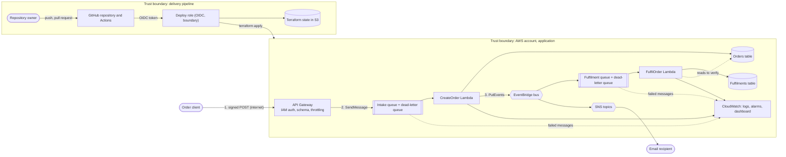

# Threat model

A STRIDE threat model of the orders stack and the pipeline that deploys it. It lists what is protected, where the trust boundaries are, which
threats apply, which control covers each one, and what is still open. Ratings are the author's judgement for this project at its current
size, not a formal score. Controls named here exist in the code; gaps are listed rather than hidden.

**Scope:** the `dev` and `prod` environments as defined in `terraform/` (the order API, both queues, the Lambdas, the bus and the topics), the GitHub Actions pipeline, and the Terraform state. **Out of scope:** the
security of AWS and GitHub themselves, takeover of the owner's AWS or GitHub account, physical access, and the email provider.

## Assets

| Asset | Why it matters |
|---|---|
| Order records (`Orders` table: `orderId`, `itemId`, `quantity`, `customerId`) | Business data; `customerId` may identify a person |
| Fulfilment records (`Fulfilments` table) | Integrity: a record means an order was processed |
| The `OrderCreated` event flow | Drives fulfilment and notifications; a forged or lost event has business effect |
| AWS account and the deploy role | Compromise would allow changes to every resource |
| Terraform state | Describes all resources and holds the subscription email addresses in plain text |
| Source repository and workflows | Whoever controls `deploy.yml` on a deployable branch controls what is deployed |

## Actors

| Actor | Trust |
|---|---|
| Order client | Untrusted. It reaches the internet-facing API, but only a request signed by a principal allowed `execute-api:Invoke` gets past authorisation, so in practice it is another service or an operator, not an end user |
| Other principals in the AWS account | Partly trusted. They can be granted `events:PutEvents` or `sqs:SendMessage`, and the owner's permission set can do both |
| Repository owner | Trusted, and the only person with write access |
| GitHub Actions runner | Trusted only while running reviewed workflow code, and only for jobs in the `dev` or `prod` environment |
| Email recipient | Receives only an order ID and a timestamp |

## Data flow and trust boundaries

## Threats

Rating is the residual risk after the listed controls: **Low**, **Medium** or **High**.

### Order flow

| ID | STRIDE | Threat | Existing controls | Residual | Open item |
|---|---|---|---|---|---|
| T1 | Spoofing | A caller who should not create orders does so | `AWS_IAM` authorisation: a request must be signed by a principal allowed `execute-api:Invoke`, otherwise `403`. Requests are schema-validated and throttled at the stage. Verified live on 2026-10-17: an unsigned request got `403` and a signed one `202` | Medium | There is no end-user identity (no Cognito or other authorizer), so the API is not safe to hand to browsers or customers. Any principal in the account granted `execute-api:Invoke` can place orders |
| T2 | Tampering | Hostile or unexpected fields in an order body | Allow-list of `customerId`, `itemId`, `quantity` with type and length limits; unknown fields dropped; 256 KB body limit | Low | None |
| T3 | Tampering | A client sets its own `orderId` or `createdAt` | Both are generated server-side and cannot be overridden | Low | None |
| T4 | Tampering | An order line overwrites another | Single transaction with `attribute_not_exists(orderId)`; a duplicate rejects the whole order | Low | None |
| T5 | Spoofing | A forged `OrderCreated` event is put on the bus by another principal in the account | The bus policy denies `events:PutEvents` to every principal except the `CreateOrder` role, administrators included. `FulfilOrder` also checks each event against the stored order (same customer, same lines, same quantities) before recording anything. Verified live on 2026-10-17: a hand-made `PutEvents` from an administrator identity was refused with `AccessDeniedException`, and a normal order was still fulfilled | Low | An attacker would need to take over the `CreateOrder` role, or change the bus policy and write matching rows into `Orders`. Both are outside what a plain `PutEvents` permission allows |
| T6 | Tampering | A message is sent straight to the queue | Messages are re-validated, then checked against the stored order; invalid, forged or altered ones fail, are retried and dead-lettered, and the alarm fires. Tested live on 2026-10-17: unparseable input, and a well-formed event for an order that does not exist, were both rejected with no fulfilment record, were dead-lettered after four receives, and fired the alarm about 11 minutes after they were sent | Low | A principal with `sqs:SendMessage` can still add noise to the queue; it costs retries and a dead-letter alarm, not a false fulfilment |
| T7 | Repudiation | Nobody can say who created an order | Order and message IDs are logged; the API request ID is the `orderId`, so one request maps to one order | Medium | No caller identity is stored. API access logging is off, because it needs an account-wide API Gateway CloudWatch role shared with other projects. Whether CloudTrail covers these services is not verified |
| T8 | Information disclosure | Order data leaks through notifications | The notification carries only `orderId` and a timestamp | Low | The SNS topics are not KMS-encrypted |
| T9 | Information disclosure | Order data at rest or in transit | DynamoDB encryption at rest (AWS-managed key), SQS-managed encryption, TLS-only policies on queues and topics | Low | No customer-managed key; no field-level protection of `customerId` |
| T10 | Information disclosure | Order contents leak through logs | Logs record message IDs and error types, never bodies; error responses are generic | Low | None |
| T11 | Denial of service | A flood of create requests exhausts concurrency or raises cost | Stage throttling (10 requests per second, burst 20), request validation before anything is queued, a queue that absorbs bursts, consumer concurrency capped at 5, on-demand billing, bounded retries and short client timeouts | Low | No per-caller quota, no reserved concurrency, no budget alarm |
| T12 | Denial of service | Poison messages block fulfilment | Partial-batch failure reporting, 3 receives then dead-letter, 14-day dead-letter retention, concurrency capped at 5 | Low | The main queue keeps the 4-day default retention |
| T13 | Denial of service | Failed orders pile up unnoticed | Alarm on dead-letter queue depth to an alerts topic. Tested | Low | Redrive from the dead-letter queue is untried |
| T14 | Integrity | An order is saved but its event is not published | The message stays on the queue until both steps succeed. A retry finds the order saved, confirms it matches the message, and publishes again | Low | After three failed attempts the message goes to the intake dead-letter queue and the alarm fires (tested live on 2026-10-17: three attempts 180 seconds apart, the move on the fourth receive, the alarm about 11 minutes after the order was sent), leaving the order saved but unannounced until it is redriven (untried) |
| T15 | Integrity | One order is processed twice (a redelivered or concurrent message) | `CreateOrder` claims each `orderId` in a processing table with a conditional write and a lease, so two copies cannot both proceed; a completed order returns its stored result and saves and publishes nothing; the result can be recorded only by the lease holder and a completed record is never overwritten; an `orderId` reused for different content is rejected; records expire after seven days, longer than the queue's retention. `FulfilOrder` is idempotent too. Verified live on 2026-10-18: a message delivered twice created one order and one record, and the second delivery logged that nothing was repeated; twelve simultaneous deliveries of one message created the order once; the same `orderId` with different content was rejected and left the stored lines unchanged | Low | The event can be published twice only if `CreateOrder` publishes and then fails to record the result before its lease ends; the consumers tolerate it, but a notification email could repeat in that window. A client that retries the whole HTTP request still creates a second order, because the order ID is the API's request ID |
| T24 | Tampering | A forged or altered message is sent straight to the intake queue | The queue policy denies `SendMessage` to everyone except the API's role, administrators included. `CreateOrder` re-validates every field, drops unknown ones, and rejects a message that reuses a stored `orderId` with different content. Verified live on 2026-10-17: a `SendMessage` from an administrator identity was refused with `AccessDenied` | Low | A caller who could assume the API's role could queue any order |
| T26 | Information disclosure | The API's error responses reveal internals or echo input | Validation failures return a fixed `400` message, queue errors a fixed `500`; no response includes the request body. Verified live on 2026-10-17: a body with an extra field and a zero quantity got `400 {"message":"Invalid request"}`, and a non-JSON content type got `415` | Low | None |
| T28 | Integrity | The API accepts an order that `CreateOrder` can never create, such as one that repeats an `itemId` | The API's request template rejects a repeated `itemId` with `400 Invalid request` before anything is queued; `CreateOrder` validates again and rejects it before anything is saved or published, and a message that still fails is dead-lettered with an alarm (the dead-letter path was verified live on 2026-10-17) | Low | None. Verified live on 2026-10-18: an order with the same `itemId` twice, adjacent or apart, got `400 {"message":"Invalid request"}`, and the processing table did not change, so nothing was queued |
| T29 | Tampering | A message reuses an existing `orderId` with different content, to alter or hijack an order | The processing record stores a fingerprint of the order. A claim or a redelivery with a different fingerprint is rejected and nothing is saved or published; a completed record cannot be overwritten; the stored lines are compared with the message before an event is published | Low | None |
| T30 | Spoofing | Someone else publishes events through the global endpoint or straight to the secondary bus | Both buses deny `PutEvents` to every principal except the two `CreateOrder` roles, administrators included; the permissions boundary allows event publishing only on the `orders-*` buses and the `orders-*` endpoint; `FulfilOrder` checks each event against the stored order in its own Region | Low | None beyond T5 and T6. Verified live on 2026-10-18: `CreateOrder` in both Regions published through the endpoint with no errors, and the secondary bus processed events only after the failover |
| T31 | Integrity | Two Regions disagree: a replica lags, or both Regions touch one order | Events are routed to one bus at a time (replication is off), so fulfilment and notifications run in one Region; the order check fails safely and is retried when a replica has not caught up; each Region's idempotency is atomic, and an `orderId` is a unique request ID generated by the Region that took the request | Low | Conditional writes are atomic within a Region only, so the same `orderId` sent to both Regions could be processed in both and resolved last-writer-wins; the API never produces that. Events in flight in the primary at a failover are not copied to the secondary. Verified live on 2026-10-18: a rehearsed failover routed events to the secondary within 7 minutes 40 seconds and back within 97 seconds, and the global tables carried each order and fulfilment to the other Region |
| T32 | Tampering | The vendored `awscrt` library is swapped or poisoned | One exact version is pinned, a few weeks old rather than the newest; the script downloads one stable-ABI wheel over HTTPS and checks its SHA-256 before unpacking anything, refuses unsafe paths, and builds a reproducible package; the library is packaged only into `CreateOrder` and only when the switch is on | Low | Dependabot does not watch it, so upgrades are deliberate; `pip-audit` does not apply because there is no requirements file |

### Pipeline and infrastructure

| ID | STRIDE | Threat | Existing controls | Residual | Open item |
|---|---|---|---|---|---|
| T16 | Elevation of privilege | Someone other than the owner's reviewed code assumes the deploy role | OIDC trust pins the audience, the repository by immutable owner and repository ID, and the `dev` or `prod` environment. Both environments accept only protected branches, `prod` needs the owner's approval, and `main` allows changes only through a pull request with five passing checks, administrators included. `deploy.yml` never runs on pull requests, and `validate.yml` has no AWS access. No stored AWS keys. Verified live on 2026-10-17: a direct push to `main` was refused (`GH006`), and a deploy started from `main` succeeded under the environment rule | Low | The owner can still merge a change to a workflow; a second maintainer with write access would be able to as well. "Require approval for first-time contributors" for fork workflows is a repository setting and is not read by this project's code |
| T17 | Elevation of privilege | The deploy role creates a more powerful role or widens itself | It can only create or change the two Lambda roles, only with the permissions boundary attached, cannot remove the boundary, and an explicit deny blocks changes to itself and the boundary. The role is created by a separately applied bootstrap stack | Low | The bootstrap runs from a laptop with local state |
| T18 | Tampering | An automatic deploy deletes or replaces data | The deploy stops if the plan deletes or replaces anything; deletion protection is on in prod | Low | `dev` has no deletion protection and the override input exists |
| T19 | Tampering | Compromised workflow or dependency | Actions pinned by commit SHA (a repository setting enforces it, and Dependabot proposes a grouped update pull request every week, which runs all five checks), provider versions locked, tool versions pinned, Lambdas use only the standard library and the runtime's `boto3`, scans on every pull request | Low | Transitive packages of `bandit` and `checkov` are not pinned; they run without AWS credentials |
| T20 | Information disclosure | Secrets or personal data reach the repository | Pre-commit hook and CI secret scan, git-ignored state and variable files, emails kept in repository secrets and a local file | Low | The repository is public, so the pre-commit hook, the CI scan and GitHub's push protection are the safeguards. Anything that does get through is rotated, not just removed |
| T21 | Information disclosure | Terraform state leaks | Private, versioned, encrypted bucket, TLS-only, native locking; the deploy role can reach only this project's key prefix | Low | State holds the subscription emails in plain text (marked sensitive only in plan output) and sits in a bucket shared with another project |
| T22 | Information disclosure | Account details appear in public CI logs | A workflow step registers the AWS account ID as a mask before Terraform runs, so every later occurrence prints as `***`. Verified live on 2026-10-17: the first run with the step has 0 occurrences of the ID and 22 masked ARNs and URLs, and the three earlier runs that showed it were deleted | Low | Resource names, queue names and API IDs are still visible in the plan output; they are not secrets, and a plan was reviewed before the repository became public |
| T23 | Repudiation | Who deployed what | Every change is a pull request (direct pushes to `main` are refused) with a workflow run log; the role session is traceable in CloudTrail | Low | None |
| T25 | Elevation of privilege | A compromised deploy role changes an API other than this project's | The role is limited to one region and to the REST API actions the Terraform needs; it cannot create or change IAM roles outside this project's two prefixes | Low | REST API IDs are generated, so the permission cannot be scoped to this project's API by name; the role can edit any REST API in the account. Narrowing it with tags is a follow-up |
| T27 | Information disclosure | The commit history exposes a personal email address | New commits use the GitHub noreply address; scans cover file contents and every added line | Low | 19 commits carry an unlinked placeholder noreply address and the earlier ones the author's personal email, which is also public in the companion repository. Kept deliberately; a rewrite would also need the closed pull-request refs purged by GitHub. Turn on GitHub's email privacy settings |
| T33 | Elevation of privilege | Roles created in the secondary Region exceed what the application needs | The same permissions boundary applies and now covers both Regions explicitly; the deploy role was not extended, so the pipeline cannot act in the secondary Region at all; the secondary stack is applied from a workstation with the owner's identity | Low | The owner's workstation identity is trusted with both Regions |
| T34 | Denial of service | The pipeline blocks itself while the multi-region stack exists | The pipeline plans with the switch off, which would delete the secondary resources; the no-delete guard stops the run instead, so nothing is destroyed | Low | Merges that trigger a deploy fail until the switch is turned off from a workstation. This is documented, not automated |

## Residual risk summary

Closed or reduced since the first version of this model: T16 (branch protection, protected-branch environments and a `prod` approval, now that the repository is public), T22 (the account ID is masked in the logs), T5 and T6 (forged events, by the bus policy and the order check), T14 (a failed publish is now retried), T11 (throttling and validation at the edge) and, partly, T1 (the API requires signed requests).

1. **T1: no end-user authentication.** Fine for service-to-service callers; add an authorizer before exposing the API to browsers or customers.
2. **T7: no caller identity or API access logs.** Needs an account-wide API Gateway logging role and a decision on CloudTrail.
3. **T25: the deploy role can manage any REST API in the account.** Narrow it with tags.

## Keeping it current

Review this file when a new component is added, a boundary changes (for example an API in front of `CreateOrder`), or a gap above is closed.
Closing a gap should update its row and the summary in the same pull request.
